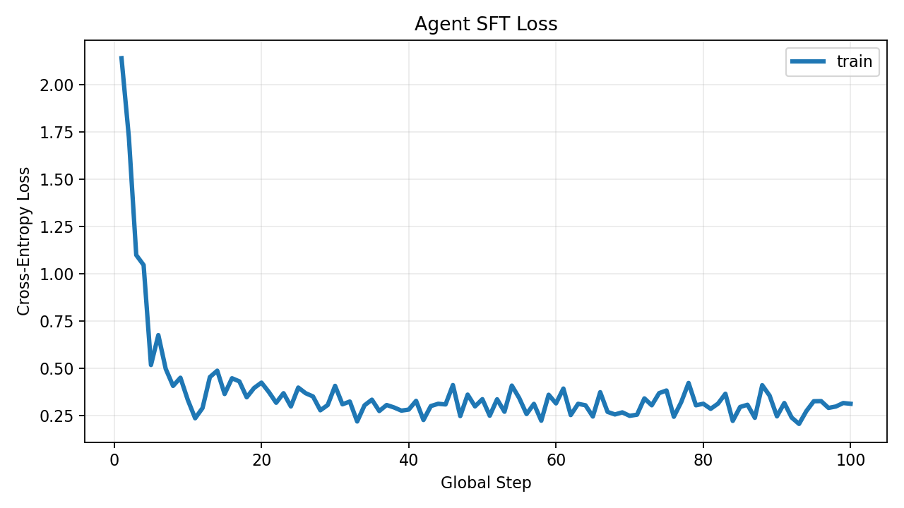
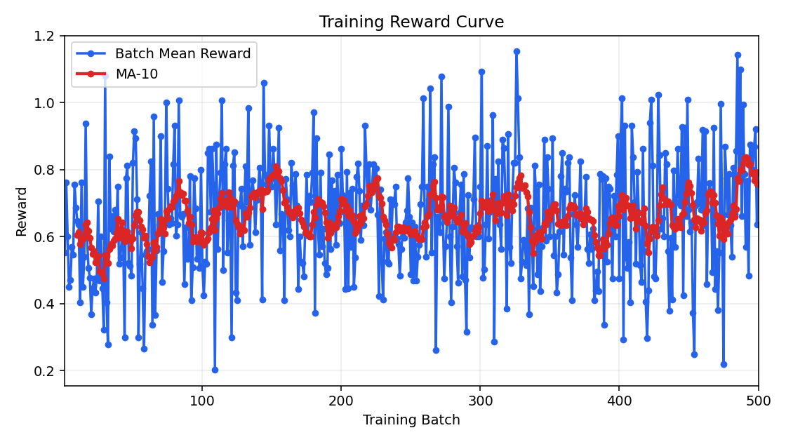

# 轻量 Search-R1 复现与改动方案

> 本项目基于 Search-R1 进行轻量化复现与改造。本文主要分享了笔者遇到的问题、改造的思路以及一些实验的结果。

## 0. 介绍

Search-R1 是一个经典 Agentic RL 项目，其核心想法是让模型在回答问题时主动使用搜索。模型可以先检索一轮，根据返回的内容判断证据是否充分，再选择继续搜索或直接作答。

我沿着这个思路做了自己的实践，但在过程中碰到了如项目完整复现算力需求大、RL过程不稳定等诸多问题，也在其中耗费数周时间以不断探索新的可能与解决方案，本文即是我在学习与复现过程中改动的记录，也希望给对 Search-R1 项目复现感兴趣，又遇到与我相同问题而倍感苦恼的同学们一些帮助与启发。

## 1. 数据构造：利用 HotpotQA 自带上下文

原版 Search-R1 的检索示例使用 Wikipedia 语料和对应索引，光是用于检索的数据就有几百 GB，如此庞大的数据量给我们数据的下载，索引的构建以及实际检索过程带来很大的麻烦。由此我想到：是否可以构造一个足以提供上下文，但较小的检索数据集？

笔者发现 HotpotQA 样本本身包含 Wikipedia 上下文，因此尝试**直接从这些上下文构造检索语料**。具体方法为：先按标题归并页面，在标题内去重句子，再把文本切成 BM25 可检索的片段。这样构建出来的语料库即足以支撑问题所需，又去除了无关语料，因此大幅缩减了复现时间。

下面是本项目实际数据量。

| 数据项 | 本次设置 |
|---|---:|
| HotpotQA 训练样本来源 | 90,447 条 |
| 构建后的 BM25 文档 | 495,407 段，每段最多 8 句 |

## 2. Agent SFT：在强化学习前加入冷启动

与原项目直接让模型从强化学习中进行学习不同，笔者在这一模块前增加了 Agent SFT 模块。加入这一步，是希望模型在进入 GRPO 前先熟悉搜索环境和动作协议，减少强化学习阶段从基础格式开始摸索所带来的大量算力开销，也增强训练的稳定性。

实际操作过程中我们先用教师模型 (本项目使用 DeepSeek V4 Flash 模型) 生成搜索轨迹，再把轨迹整理成逐轮监督数据，让 Agent 学会在不同环境状态下选择下一步动作。

> 教师轨迹会在实际 BM25 环境中执行，并经过严格的两轮筛选。第一轮根据**答案与格式的正确性**进行筛选，以除去答案或格式错误的教师轨迹；第二轮则根据**检索证据可靠性**进行筛选，除去教师轨迹中未检索到答案但却做出正确回答的样本 (这部分是由教师模型的能力作答的，应该去除)。

SFT 按决策轮次训练：每个样本的输入包含问题、此前动作和当前可见的检索结果，目标则只有下一条 Agent 动作。loss 只作用于模型当前应生成的响应，不要求它复述检索到的文档。本次训练共进行 100 步，每步全局 batch size 为 16，因此约处理 1,600 条决策轮次样本；这里的样本不是完整轨迹。

## 3. Agent 格式：把 CoT 收敛到可执行决策

我们调整了 Agent 的输出格式，让模型在每一步先给出简短的状态判断，再明确选择搜索或回答。`<think>` 部分围绕“已知信息、缺失信息、下一步动作”组织，后面接 `<search>` 或 `<answer>`。

这是一种受约束的 CoT scaffold：它保留了简短的中间判断，但不要求长篇自由推理。这样，读者可以从轨迹中看到模型为什么继续搜或停止，程序也能稳定解析动作。我们希望模型把思考直接连接到环境决策，而不是生成与搜索动作脱节的长段文字。

比如一个单轮检索的模型输出的格式：

```text
<think>known: ...; missing: ...; next: search</think>
<search>...</search>

<think>known: ...; missing: none; next: answer</think>
<answer>...</answer>
```

## 4. GRPO：在真实检索交互中优化策略

完成冷启动后，我们从冻结的 Agent SFT 模型开始做 GRPO。每个问题会采样多条搜索轨迹，模型在检索环境中尝试不同的查询与回答决策，再根据整条轨迹获得的奖励更新策略，这部分与原项目的差别不大。

我们在最终答案 EM 奖励之外加入了少量过程 shaping，让奖励也能反映检索是否提供了有效证据，以及模型是否在合适的时候停止。具体来说，轨迹最终答对时，如果模型实际看到的检索结果中包含标准答案，会额外获得 0.1；在这次命中后的下一步就直接给出正确答案，再额外获得 0.1。这里检查的是送入模型的可见检索内容（可能经过长度截断），不是检索器返回的全部原始文本。

格式方面，我们对每一次无效动作扣 0.1 分，例如输出无法解析的动作，或超过搜索次数限制后仍继续搜索；扣分按无效动作次数累计。也就是说，奖励由答案正确性作为主体，检索证据与及时停止作为小额正向 shaping，无效动作则受到小额惩罚。它不是单独的格式分类器，也不是对所有格式不规范的完整轨迹统一扣一次分。

## 5. 实验评估：训练带来的变化

我们选取了 1,000 条问题作为固定测试集，对比未做 Agent 训练的固定 RAG 基线、Agent SFT 和 Agent SFT + GRPO 三者的表现。为了确保三者在检索到的最大文档数上相同，固定 RAG 基线的 top-k 参数设置为 6，而其余二者则设置为 3 (两轮检索最大检索文档数为 2*3 = 6)。

| 底座 | 设置 | Strict EM | 格式有效率 |
|---|---|---:|---:|
| Qwen2.5-3B-Instruct | 固定 RAG 基线（未做 Agent 训练） | 40.7% | — |
| Qwen2.5-3B-Instruct | Agent SFT | 54.6% | 96.5% |
| Qwen2.5-3B-Instruct | Agent SFT + GRPO | **62.6%** | **96.9%** |
| Qwen2.5-3B Base | 固定 RAG 基线（未做 Agent 训练） | 13.8% | — |
| Qwen2.5-3B Base | Agent SFT | 56.6% | 96.7% |
| Qwen2.5-3B Base | Agent SFT + GRPO | **63.2%** | **97.7%** |

本项目使用了 Qwen2.5-3B-Instruct 与 Qwen2.5-3B Base 两种底座。实验结果表明，两种底座在经过Agent SFT 与 GRPO 后的 Strict EM 都有较为明显的提升，格式正确率也能达到较高水平。有意思的是，Qwen2.5-3B Base 模型在未经训练前表现很差 (Strict EM 仅为 13.8%)，但在经过训练后其表现甚至略优于 Instruct 模型。因此笔者建议追求训练稳定的读者可以使用 Instruct 模型，而有充足算力条件的读者则可以尝试 Base 模型。

需要注意的是这个结果只反映当前模型、数据划分和训练设置下的观察，不代表对其他任务或模型的普遍结论。且这里评估的是在 HotpotQA 固定语料上的表现，而不是对完全未见知识库的泛化。

## 6. 训练配置与耗时

本次训练使用 2 张 A800 80GB GPU。下面只展示 Qwen2.5-3B-Instruct 模型在各阶段的重要参数、用时与训练过程，供各位读者参考。

| 阶段 | 训练数据量 | 学习率 | 训练耗时 |
|---|---|---:|---:|
| Agent SFT | 约 1,600 条决策轮次样本 | 1e-5 | 约 10 分钟 |
| GRPO | 4,000 条训练问题 | 5e-7 | 约 4.5 小时 |



*Agent SFT 训练 loss*



*GRPO 每批平均 Reward 和 MA-10*

## 7. 样例展示

### 单轮检索

**问题：** The MacBook uses a series of IPS panel displays that offer what compared to traditional displays?

**模型输出：**

```text
<think>known: none; missing: comparison of MacBook IPS panels vs traditional displays; next: search</think>
<search>MacBook IPS panel displays compare to traditional displays</search>
```

**检索环境返回：**

```text
<information>Doc 1(Title: "Flat panel display") Flat-panel displays are electronic viewing technologies used to enable people to see content (still images, moving images, text, or other visual material) in a range of entertainment, consumer electronics, personal computer, and mobile devices, and many types of medical, transportation and industrial equipment. They are far lighter and thinner than traditional cathode ray tube (CRT) television sets and video displays and are usually less than 10 cm thick. Flat-panel displays can be divided into two display device categories: volatile and static. Volatile displays require that pixels be periodically electronically refreshed to retain their state (e.g., liquid-crystal displays (LCD)). A volatile display only shows an image when it has battery or AC mains power. Static flat-panel displays rely on materials whose color states are bistable (e.g., e-book reader tablets from Sony), and as such, flat-panel displays retain the text or images on the screen even when the power is off. As of 2016, flat-panel displays have almost completely replaced old CRT displays. In many 2010-era applications, specifically small portable devices such as laptops, mobile phones, smartphones, digital cameras, camcorders, point-and-shoot cameras, and pocket video cameras, any display disadvantages of flat-panels (as compared with CRTs) are made up for by portability advantages (thinness and lightweightness).
Doc 2(Title: "Retina Display") Retina Display is a brand name used by Apple for its series of IPS panel displays that have a higher pixel density than traditional displays. Apple has applied to register the term "Retina" as a trademark in regard to computers and mobile devices with the United States Patent and Trademark Office, Canadian Intellectual Property Office, and in Jamaica. On November 27, 2012 the US Patent and Trademark office approved Apple's application and "Retina" is now a registered trademark for computer equipment.
Doc 3(Title: "MacBook (Retina)") The MacBook is a line of Macintosh portable computers introduced in March 2015 by Apple Inc. The MacBook has a similar appearance to the MacBook Air, but is thinner and lighter, and is available in colours called space grey, silver, gold, and rose gold. It offers a high-resolution Retina Display, a Force Touch trackpad, a redesigned keyboard, and only two ports: a headphone jack and a USB 3.1 Type-C port for charging, data transfer and video output.</information>
```

**模型输出：**

```text
<think>known: MacBook uses Retina Display, which is IPS panel; missing: none; next: answer</think>
<answer>higher pixel density</answer>
```

### 多轮检索

**问题：** Former French professional football player, who made three goals in the 1989 Coupe de France Final, was named European Footballer of the Year in what year?

**模型输出**

```text
<think>known: none; missing: year European Footballer of the Year awarded to former French player who scored three goals in 1989 Coupe de France Final; next: search</think>
<search>French professional footballer 1989 Coupe de France Final three goals European Footballer of the Year</search>
```

**检索环境返回：**

```text
<information>Doc 1(Title: "1989 Coupe de France Final") The 1989 Coupe de France Final was a football match played at Parc des Princes, Paris, on 10 June 1989 that saw Olympique de Marseille defeat AS Monaco FC 4–3 thanks to three goals by Jean-Pierre Papin and one by Klaus Allofs.
Doc 2(Title: "2012 Coupe de la Ligue Final") The 2012 Coupe de la Ligue Final was the 18th final of France's football league cup competition, the Coupe de la Ligue, a football competition for the 42 teams that the Ligue de Football Professionnel (LFP) manages. The final took place on 14 April 2012 at the Stade de France in Saint-Denis and was contested between Lyon and Marseille. The latter club entered the match as the two-time defending champions of the competition and sought to become the first club in French football history to win the competition three consecutive years after previously becoming the first club to win the competition in back-to-back seasons. Lyon made its first finals appearance since the 2008 Coupe de France Final and played at the Stade de France for the first time in nearly three years. The final was broadcast live on public network broadcaster France Télévisions.
Doc 3(Title: "Coupe de France") The Coupe Charles Simon, commonly known as the Coupe de France (] ), is the premier knockout cup competition in French football organized by the French Football Federation. The cup competition is named after Charles Simon, a French sportsman who died while serving in World War I, and is open to all amateur and professional football clubs in France, including clubs based in the overseas departments and territories. The final is played at the Stade de France and the winner of the Coupe de France qualifies for the group stage of the UEFA Europa League. The reigning champions are Paris Saint-Germain who defeated Angers in the final of the 2016–17 competition.</information>
```

**模型输出：**

```text
<think>known: player is Jean-Pierre Papin; missing: year he was European Footballer of the Year; next: search</think>
<search>Jean-Pierre Papin European Footballer of the Year year</search>
```

**检索环境返回：**

```text
<information>Doc 1(Title: "Jean-Pierre Papin") Jean-Pierre Papin (] ; born 5 November 1963 in Boulogne-sur-Mer) is a former French professional football player, who played as a forward, and who was named the European Footballer of the Year in 1991.
Doc 2(Title: "Stade Jean-Pierre Papin") The Stade Jean-Pierre Papin is a football (soccer) stadium in Lesquin, France. It is currently the home of Championnat de France Amateurs Group A side US Lesquin. The stadium has a capacity of 1,500 people.
Doc 3(Title: "Gunnar Andersson (footballer)") Gunnar Andersson (14 August 1928 – 1 October 1969) was a football player from Sweden. He is widely considered as one of Olympique de Marseille's best strikers, along with Josip Skoblar and Jean-Pierre Papin.</information>
```

**模型输出：**

```text
<think>known: Jean-Pierre Papin named European Footballer of the Year in 1991; missing: none; next: answer</think>
<answer>1991</answer>
```

## 8. 参考文献

- [1] Bowen Jin, Hansi Zeng, Zhenrui Yue, Jinsung Yoon, Sercan O. Arik, Dong Wang, Hamed Zamani, and Jiawei Han. 2025. Search-R1: Training LLMs to Reason and Leverage Search Engines with Reinforcement Learning. In *Proceedings of the 2nd Conference on Language Modeling (COLM 2025)*, Montreal, Canada, October 7–10, 2025. https://openreview.net/forum?id=Rwhi91ideu
- [2] PeterGriffinJin. 2025. *Search-R1* [Computer software]. GitHub repository. https://github.com/PeterGriffinJin/Search-R1
